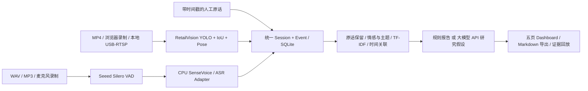

# HUB ONE · Experience Intelligence

**当前优先级：Evidence-to-Decision 决策型研究报告。** 研究问题 → 行为/原话 → 时间戳证据 → 诊断及替代解释 → 改进选项 → 下一轮验证实验。已提供 Ollama/OpenAI/Anthropic/自定义统一接口；本轮在 Codex Cloud **只用 Mock + 模拟 Session 验证软件流程**，没有验证真实 Ollama、RTX 5070 或实体摄像头/麦克风。3D 空间模块保持不变。

- [报告引擎、Schema、Prompt 与 API](docs/EVIDENCE_TO_DECISION.md)
- [Windows 启动、连接 Ollama 与真实采集](docs/WINDOWS_EVIDENCE_TO_DECISION.md)
- [本轮软件验收及未验证项](docs/DECISION_ACCEPTANCE.md)

启动现有后端后打开 `http://127.0.0.1:8000/#report`，点击 **运行软件流程演示 · SIMULATED + MOCK**。也可执行 `python scripts/accept_decision.py` 导出可追溯的模拟决策报告。该引擎需要后端；[在线 Mock 报告](https://niko1010.github.io/hub-on/?v=decision-1#report) 是静态回放，不运行模型。GitHub main 的资料范围见 [公开包说明](docs/PUBLIC_EXPORT.md)。

**V0.3 可交互三维空间视图**：[说明与数据边界](docs/SPACE_3D_V0.3.md)。Three.js 正交等轴测、两层切换/总览/爆炸视图、旋转缩放平移、区域高亮与右侧联动，保留 2D。平面来自真实 CAD；缺失高度、支撑楼板和演示运营数据明确标记 SIMULATED。

[V0.3 验收记录](docs/V0.3_ACCEPTANCE_REPORT.md)：56 项后端/数据测试、29 项最终静态三维交互检查，并通过原二维与 C3 回归。

**[在线打开 Space Intelligence](https://niko1010.github.io/hub-on/#space)** · [在线版范围与发布说明](docs/GITHUB_PAGES.md)。在线版支持真实 CAD 地图交互与 C3 SIMULATED 回放；视频上传和模型分析使用完整本地后端。

**V0.2 Space Intelligence 已加入独立一级入口**：苏州观前街1号真实 CAD → 一/二层 JSON 与 SVG → 可缩放、平移、框选、切换图层和查看原始对象的地图。继续保留 Crest C3 Experience Lab，不重建架构。

- [V0.2 验收报告](docs/V0.2_ACCEPTANCE_REPORT.md)：47 项测试、38 项浏览器检查及明确的未完成/未验证事项。
- [CAD 解析报告](docs/CAD_PARSING_REPORT_V0.2.md)：图层/块/坐标、楼层识别依据、PDF 核对与原始文件 hash。
- [Windows / Linux 运行与部署](docs/SPACE_DEPLOYMENT.md) · [空间 API 与实际响应](docs/SPACE_API_V0.2.md)。
- [3D Spatial Digital Twin 目标与数据契约](docs/SPATIAL_DIGITAL_TWIN.md)：JSON 与 SVG 分离、稳定空间 ID、XYZ 和三维字段；未知高度与标高为 null。Three.js/R3F 完整三维渲染留待后续阶段。

已有环境更新依赖后启动：

```bash
.venv/bin/python -m pip install ezdxf==1.4.4
.venv/bin/python -m uvicorn backend.main:app --host 0.0.0.0 --port 8000
```

Windows 使用 `.venv\Scripts\python`，或按上述部署文档安装后运行 `START_WINDOWS.cmd`。在运行服务的本机打开 `http://127.0.0.1:8000/#space`；远程浏览器使用实际服务器/端口转发地址。空间页不需要 GPU、模型权重或真实摄像头。

数据在 `space_intelligence/data/`，原始 DXF/PDF 在 `space_intelligence/source/`，离线重建命令为 `python -m space_intelligence.cad.extract`。空间 API 前缀 `/api/v1`，交互文档 `/docs`。源数据采用毫米 WCS，保留原始 XYZ、句柄、图层与嵌套变换。

**已知资料问题：上传的两份 PDF 页面均为一层。** 二层由 DXF 独立图块和标题确定，二层 PDF 核对仍待补充。业务区域、真实设备、客流、热力、动线等默认 NOT CONNECTED；显式勾选测试设备才显示 SIMULATED 点位和覆盖扇形，不代表真实安装点。

## Crest C3 Experience Lab（V0.1）

V0.1 冻结验收：[验收报告](docs/V0.1_ACCEPTANCE_REPORT.md) · [Windows 本地部署与验收](docs/WINDOWS_DEPLOYMENT_V0.1.md)。本轮只修复来源标记、接口兼容和展示/时间偏移问题，没有重写架构。

可在 CPU 上运行的多模态消费者体验研究 Demo：视频人体/姿态/轨迹观测 + 中文语音转录 + Session 事件日志 + 反馈主题 + 证据关联 + 产品研究报告。

**默认演示使用明确标记的 SIMULATED 素材，视觉和 ASR 实际执行模型推理。** 无 API 密钥时运行透明规则基线；不会声称已经调用大模型。专属的穿戴、腰带调整、上坡等行为只是预设人工标注，未伪装成视觉识别。

## 1. 项目架构



```text
backend/      FastAPI、Schema、后台任务、WebSocket、媒体接口
frontend/     无构建依赖的 HTML / CSS / ES Modules 五页界面
adapters/     RetailVision / SenseVoice / Whisper / HTTP ASR / LLM / 本地采集
vision/       视频采样、区域、活动规则、证据截图、专属行为扩展 Protocol
audio/        ffmpeg 规范化、Seeed VAD、转录事件
analysis/     分句、关键词、情感/意图基线、主题分组、关联、报告
database/     SQLite Session / Asset / Event / Job / Report
third_party/  保持原样的 RetailVision 必要源码、许可和文件 SHA 清单
sample_data/  SIMULATED 文本输入与可生成的音视频/脚本/来源清单
scripts/      安装、模型下载、合成资料、演示、浏览器验收、本地采集
tests/        API、隔离、证据、异常、规则、真实 CPU 模型测试
docs/         实际源码调研、精确上游提交、验证记录
runtime/      自动创建的 SQLite、上传、证据帧、JSON/Markdown 报告
```

运行一个服务即可，不需要 Docker、数据库服务器、Node 构建或 GPU。任务在线程池中执行，SQLite 持久化进度；同一 Session 的写入串行。**用单个 Uvicorn worker**，不承诺多实例/生产部署。

## 2. 四个开源项目的实际复用

| 原项目 | 本 Demo 的处理 |
|---|---|
| [RetailVision](https://github.com/Jay14090/retailvision) | 直接保留并调用人体检测、IoU 追踪、姿态、活动特征/规则、区域和视频探测模块。CPU YOLO11n-pose 同时提供人体框和姿态模型。 |
| [Bristlenose](https://github.com/cassiocassio/bristlenose) | 实际研究转录合并、quote 提取/聚类、时间戳、情感/意图结构；借鉴有原话证据的研究流程，没有复制其 AGPL 实现。 |
| [Store Intelligence](https://github.com/ranjitcj/store-intelligence) | 实际研究 FastAPI ingest、VisitorSession、事件存储/防重和统计；参考分层，自建轻量 SQLite 模型；未复制许可不明源码。 |
| [Seeed Retail AI](https://github.com/Seeed-Projects/Lab-Prooject-RK) | 直接抽取 Apache-2.0 的 Silero StreamingVad 状态机；保留 Qwen3 HTTP ASR 适配接口，参考 turn 结构和广播方式。未部署 RK/VoxEdge/CAM++ 硬件栈。 |

详见 [源码调研](docs/SOURCE_REVIEW.md)、[上游精确提交](docs/upstream-manifest.json) 和 [第三方许可说明](THIRD_PARTY_NOTICES.md)。原始克隆在当前机器 `/workspace/upstream/`，未修改。其他机器可用 `python scripts/clone_upstreams.py --directory ../upstream` 重建；Demo 本身不需要这四个完整仓库。

## 3. 环境安装（Linux / Codex CPU）

已在 **Python 3.12、CPU、ffmpeg、系统 Chromium** 的当前 Codex 环境中验证。建议至少 4 GB 可用内存、3 GB 磁盘；初次需下载 PyTorch 和官方模型。下载均保持 TLS 校验并检查固定 SHA-256。

```bash
cd /workspace/hub-on/hubone-crestc3-demo
python3 -m venv .venv
.venv/bin/python -m pip install torch==2.7.1 torchvision==0.22.1 --index-url https://download.pytorch.org/whl/cpu
.venv/bin/python -m pip install -r requirements.txt
# 需要 ffmpeg 和 ffprobe；本云环境已安装。普通 Ubuntu 可用包管理器安装 ffmpeg。
.venv/bin/python scripts/download_models.py
.venv/bin/python scripts/generate_samples.py
.venv/bin/python -m pytest -q
```

也可执行 `bash scripts/install.sh`。已验证内容可复用，下载器会校验缓存。生成的媒体/清单、虚拟环境、模型和运行数据已 gitignore，安装不修改应用源码和锁定的上游文件。

`.env` 可选：复制 `.env.example` 后按需修改；不要提交真实密钥。默认 CPU、SenseVoice 文件 ASR、Silero VAD 和规则报告，无需密钥。基础依赖固定在 `requirements.txt`，CPU torch/torchvision 单独安装，避免拉取 CUDA 大包。

网络目的地：`github.com`、`release-assets.githubusercontent.com`、`raw.githubusercontent.com`、`registry.npmjs.org`（非必需，本前端无 npm）、`pypi.org`、`files.pythonhosted.org`、`download.pytorch.org`、`download-r2.pytorch.org`。当前真实运行不需要 Hugging Face。

## 4. 启动与完整演示

```bash
bash scripts/start.sh
# 等价：.venv/bin/python -m uvicorn backend.main:app --host 0.0.0.0 --port 8000
```

本地浏览器打开 `http://localhost:8000`，API 文档 `/docs`，健康检查 `/api/health`。云端由环境提供的端口访问方式打开，不能从云端访问你的本地摄像头。

点击 **运行完整演示 SIMULATED**：

1. 新建独立的模拟 Session，接入约 23 秒视频和中文合成语音。
2. CPU YOLO、IoU 追踪、姿态和基础活动规则实际运行，保存证据帧。
3. Seeed VAD + SenseVoice INT8 **实际转录**合成音频，保留错字和未知说话人。
4. 加入明确标为人工/SIMULATED 的穿戴、腰带调整、上坡等预设情境。
5. 生成关键词、正负反馈、主题组、语音与视频时间关联、研究假设及 Markdown 报告。
6. 依次查看“体验时间轴 → 消费者反馈 → 产品洞察 → 研究报告”，点击证据 ID 回看原话、音频区间和模型截图。

命令行执行相同真实模型链路，并下载报告/事件/任务统计：

```bash
.venv/bin/python scripts/demo.py --output artifacts/real-cpu-demo
```

明确的离线 fixture 版本：`python scripts/demo.py --fixture`。这个模式的语音文字从已校验 SHA 的脚本读取，事件显示 `SIMULATED/fixture-sidecar`，**不属于 ASR 模型输出**。fixture 不能为任意上传音频生成假转录。视频仍执行真实模型。

## 5. 上传自己的视频、音频与转录

界面点“新建体验”；若是演练/合成资料，先勾选“新体验为模拟资料”。上传视频和音频，分别点击分析。支持 MP4/MOV/AVI/WebM 和 WAV/MP3/M4A/OGG/WebM，单文件 200 MB、最长 10 分钟；长资料先裁剪，不会静默截断后冒充完整输入。

视频与音频可能不是同时开始：在“起点偏移（秒）”填写各自相对 Session 起点的位置。例如视频在第 0 秒开始，音频在第 12 秒开始，填 0 和 12。事件遵循：

```text
Session timestamp = 文件时间 + offset_seconds
created_at = UTC 墙钟，只作展示，不参与媒体关联
```

无音频或 ASR 识别有误时，展开“手动输入带时间戳的转录文本”。每行：

```text
5 | 8 | P01 | 穿起来还可以，但是腰部有点紧。
10 | 13 | P01 | 上坡的时候感觉助力还不错。
15 | 18 | P01 | 走久了之后感觉有一点重。
```

人工转录保存为 `source=manual`，带 `origin=manual_text`，不冒充 ASR；用户填的 P01 不是声纹识别。也可填写带时间的人工行为观察。当前文本录入是追加资料，避免把同一句重复录入当作多位消费者。

API 示例（先把 SESSION_ID 替换为创建结果）：

```bash
curl -X POST http://localhost:8000/api/sessions -H 'Content-Type: application/json' \
  -d '{"name":"Crest C3 测试","simulated":false}'
curl -X POST http://localhost:8000/api/sessions/SESSION_ID/assets \
  -F kind=video -F file=@experience.mp4
curl -X POST http://localhost:8000/api/sessions/SESSION_ID/assets \
  -F kind=audio -F file=@feedback.wav
```

拿到 `asset_id` 后提交对应任务：

```bash
curl -X POST http://localhost:8000/api/sessions/SESSION_ID/video \
  -H 'Content-Type: application/json' -d '{"asset_id":"VIDEO_ASSET_ID","offset_seconds":0}'
curl -X POST http://localhost:8000/api/sessions/SESSION_ID/audio \
  -H 'Content-Type: application/json' -d '{"asset_id":"AUDIO_ASSET_ID","offset_seconds":0}'
curl http://localhost:8000/api/sessions/SESSION_ID/jobs/JOB_ID
```

精确区域通过 video 请求的 `zone` 字段设置：归一化点列表，例如 `[[0.1,0.2],[0.9,0.2],[0.9,0.95],[0.1,0.95]]`。未进行地面标定，不能将坐标称为米或从中推算实际坡度。

纯文本输入：先创建 `simulated=true` 的 Session，再 `POST /api/sessions/SESSION_ID/transcripts`，请求体可直接使用 `sample_data/manual_transcript.example.json`。

## 6. ASR、麦克风与大模型

### ASR 适配器

| ASR_PROVIDER | 能力 / 前置条件 |
|---|---|
| `sherpa`（默认） | CPU SenseVoice INT8，中英等语言；官方 GitHub 包由下载器准备；VAD 提供段级边界，不是逐字时间戳。 |
| `openai` | OpenAI-compatible `/audio/transcriptions`；配置 ASR_BASE_URL、ASR_API_KEY、ASR_MODEL。未返回 segment 时只保留整段时间，不伪造细分对齐。 |
| `qwen` | 对接 Seeed 的 `QWEN_ASR_URL/asr?language=zh`；服务需在本地或可访问地址先启动。 |
| `faster-whisper` | 可选 `requirements-asr.txt` + 本地 CTranslate2 模型目录 `ASR_MODEL_PATH`，仅 CPU INT8、禁止处理时自动下载。当前云网络不允许 HF，未验证真实 Whisper 模型。 |
| `none` | 如实报缺少 ASR，可改用人工文本；不返回假转录。 |

未安装说话人模型，默认 `speaker=null`。只有显式 API 返回或人工指定标签才保留；不会按片段交替指定说话人。Say emotion/intent 由文本规则预分类，不是通过声纹读出心理状态。

浏览器“开启摄像头预览 / 录制体验 / 录制麦克风”使用本地 `getUserMedia` 和 `MediaRecorder`，需要用户的设备权限和 HTTPS/localhost。视频录制包含同一条录制的音轨，两者用共同偏移上传。**识别在停止录制并上传后进行**，事件处理期间通过 WebSocket 广播；没有声称已完成逐帧低延迟流式 ASR。云环境未实测用户的实体摄像头/麦克风。

### LLM 语义洞察

本轮本地优先使用 Ollama，操作见 [当前 Windows 说明](docs/WINDOWS_EVIDENCE_TO_DECISION.md)。若切换 OpenAI，在服务环境或不入 Git 的 `.env` 显式配置：

```dotenv
LLM_PROVIDER=openai
LLM_BASE_URL=https://api.openai.com/v1
LLM_MODEL=gpt-4o-mini
LLM_API_KEY=在本地环境变量中安全配置
```

云端需在环境设置中配置允许的 API 域名和安全凭据；不要在聊天或 Git 填真实值。前端不接收密钥。选择“大模型 API”再分析，或：

```bash
curl -X POST http://localhost:8000/api/sessions/SESSION_ID/analyze \
  -H 'Content-Type: application/json' -d '{"provider":"llm"}'
```

当前决策报告使用 JSON Schema；Anthropic 使用强制结构化工具返回。输出通过 Pydantic Schema 和当前 Session 证据/选项/实验 ID 校验；不存在的引用、错误结构和失败请求会导致任务失败，**不会静默降级为成功报告**。事实记录、研究推断与证据不足分别标记，语义与模型质量仍需研究员复核。本轮没有进行真实 LLM 调用，四类 Provider 仅通过 Mock HTTP 协议测试。

本机 Ollama 使用 `LLM_PROVIDER=ollama`、`LLM_BASE_URL=http://127.0.0.1:11434/v1`、`LLM_MODEL=实际模型名`，Key 可为空。loopback 的 OpenAI-compatible 服务同样可免密；远程 openai 模式仍需凭据。具体真实调用验收命令和限制见 Windows 说明，HTTP mock 通过不等于真实 LLM 推理已验证。

## 7. 数据与最终报告

事件包含 `event_id, session_id, timestamp, event_type, source, description, confidence, evidence, metadata`。来源为 video/audio/AI_analysis/manual。人体检测 confidence 不代表行为规则准确率；手动输入与未知 ASR 置信度保留 null。

当前 Markdown 以研究问题、可观察记录、原话、时间证据、诊断/替代解释、产品选项、实验和当前决策为主线；关键词、正负反馈和主题组继续保留在结构化 JSON 与反馈页面。报告附完整证据索引、限制和事件快照 hash。主题组数量/原话数/分句数不是消费者人数，单 Session 不能证明人群趋势。

离线方案是领域规则 + 字符 TF-IDF；主题先按产品方面分组，再计算组内相似度，**不是训练出的语义聚类模型**。对反讽、跨句否定和识别错字可能误判。VAD 前卷保留轻声开头，但仍可能出现 ASR 错字；原输出和音频都可回放。

研究报告页点“导出 Markdown”。API：

- `/api/sessions/SESSION_ID/report`：完整 JSON，包括原始事件证据映射。
- `/api/sessions/SESSION_ID/report.md`：下载 Markdown。
- `/api/sessions/SESSION_ID/events.json`：下载统一事件。
- `/api/sessions/SESSION_ID/feedback`、`/stats`：Dashboard 数据。
- WebSocket `/api/sessions/SESSION_ID/stream`：持久化事件快照 + heartbeat。

服务器还保存 `runtime/reports/SESSION_ID/report.md` 和 `report.json`。添加/重新处理资料会使旧报告和派生洞察失效，需重新分析。重复处理同一媒体替换该媒体上次事件，不会累计成重复证据。后台任务状态落 SQLite，服务重启后未完成任务标为中断失败，重跑即可。

当前没有 PDF 导出；Markdown 已实现并验证，可用常规 Markdown 工具另行转 PDF。

## 8. Windows + RTX 5070 本地部署

云端只验证 CPU；以下为本地部署命令，未声称已在你的硬件运行。推荐 Python 3.12、Windows 11、最新兼容 NVIDIA 驱动。RTX 5070 是 Blackwell，视觉 GPU 可使用 PyTorch 的 **CUDA 12.8** 构建，不能沿用原项目仅为旧卡选的 cu126。

```powershell
cd hubone-crestc3-demo
py -3.12 -m venv .venv
.\.venv\Scripts\python -m pip install torch==2.7.1 torchvision==0.22.1 --index-url https://download.pytorch.org/whl/cu128
.\.venv\Scripts\python -m pip install -r requirements.txt
winget install --id Gyan.FFmpeg -e
# 安装 ffmpeg 后新开 PowerShell 确认 ffmpeg -version
.\.venv\Scripts\python scripts\download_models.py
.\.venv\Scripts\python scripts\generate_samples.py
.\.venv\Scripts\python -c "import torch; print(torch.cuda.is_available()); print(torch.cuda.get_device_name(0))"
$env:VISION_DEVICE="cuda"
.\.venv\Scripts\python -m uvicorn backend.main:app --host 127.0.0.1 --port 8000
```

如只需 CPU，把 torch 安装源换为上方 `/whl/cpu`，并设 `VISION_DEVICE=cpu`。SenseVoice 默认仍使用 CPU ONNX，视觉 GPU 与 ASR CPU 独立，不需要下载/训练新模型。摄像头可用浏览器按钮，或：

```powershell
.\.venv\Scripts\python scripts\capture.py --source 0 --duration 15 --output runtime\usb.mp4
# RTSP 同样走本地文件录制接口：--source "rtsp://设备地址/stream"
```

RTSP 的可达性、设备认证和取流权限由本地环境提供；不要把设备密码提交到仓库。采集适配器是后续 USB/RTSP 接入点，云端没有实测设备。

## 9. 测试与演示验收

```bash
.venv/bin/python -m pytest -q                  # 包含真实 CPU 模型集成
.venv/bin/python -m pytest -q -m 'not integration' # 不需要模型推理的核心测试
.venv/bin/python scripts/demo.py             # 需先启动 HTTP 服务
```

可选浏览器验收：

```bash
.venv/bin/python -m pip install -r requirements-browser.txt
.venv/bin/python -m playwright install chromium
.venv/bin/python scripts/browser_smoke.py
# 云环境已有系统 Chromium 可用：--chromium /usr/bin/chromium
```

浏览器验收覆盖五页、真实文件上传、证据弹窗、Markdown 下载、390px 窄屏和 JS 错误。产物在 `artifacts/browser/`。当前验证结果与已知限制见 [VALIDATION.md](docs/VALIDATION.md)。Codex 受限命令沙箱可能阻止 TestClient 跨线程唤醒和本机连接；在环境允许的本机通信执行上下文运行，不能因此关闭应用断言。

这是单研究工作台 Demo，无企业权限。请在受控本地/演示环境使用；不是公开多人 SaaS。
